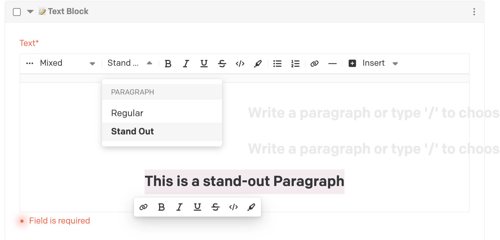
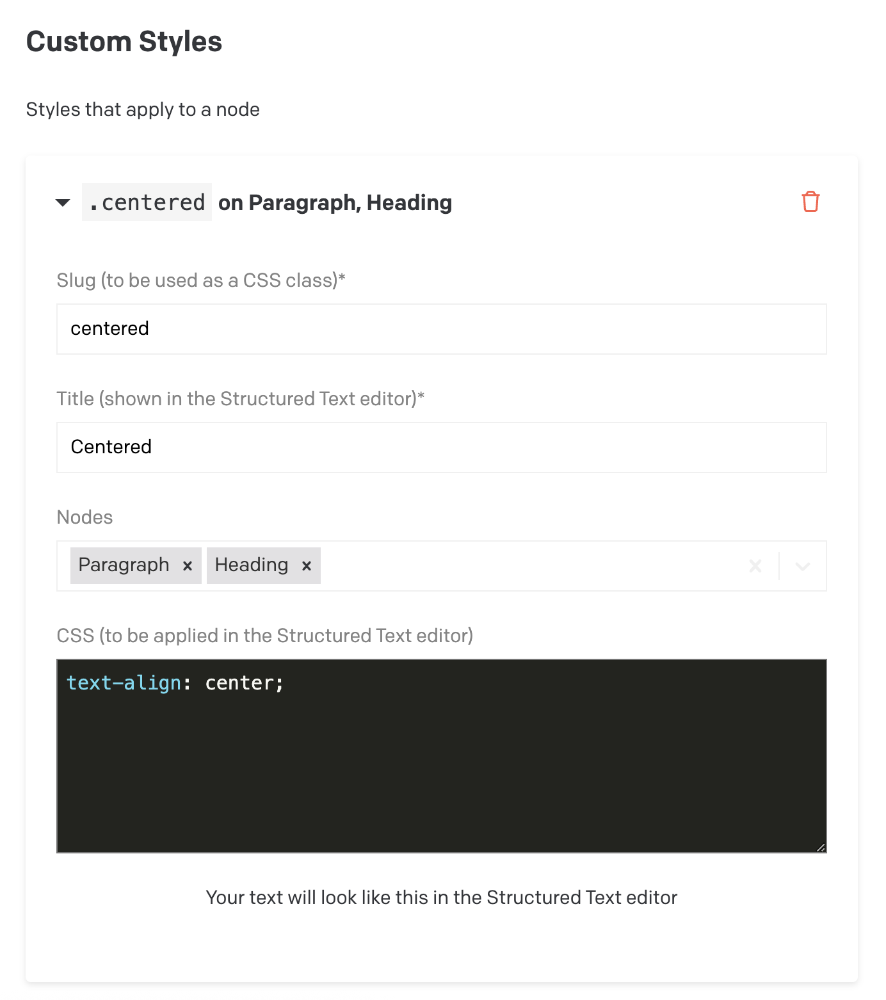
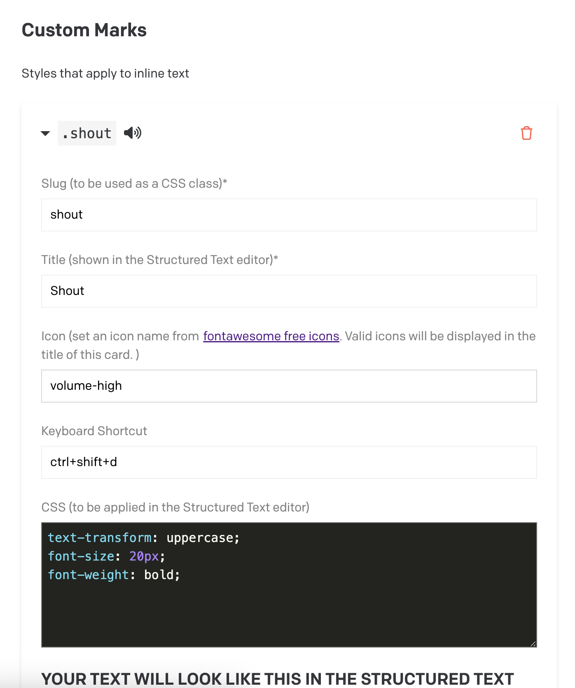
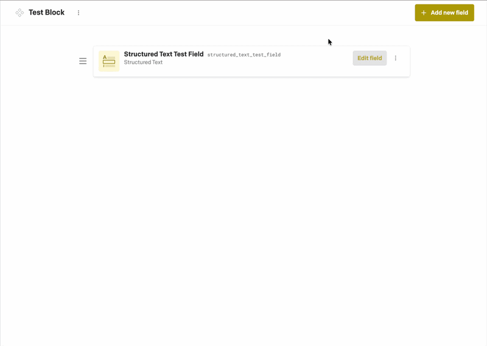

# DatoCMS plugin: Custom Text Styles

This DatoCMS plugin adds custom styles and marks to the editor of Structured Text fields. You define them with CSS in the plugin settings, and editors pick them from the toolbar.



## Features

- Add custom styles (for headings and paragraphs) to the Structured Text editor
- Add custom marks (inline styles) to the Structured Text editor
- Choose which styles and marks are available per field, so per block
- Render the styles and marks on your front end as CSS classes

## Configuration

### Plugin Settings

#### Custom Styles

Add your own Custom Styles. You can set the following attributes:

##### `Slug`
Set this slug to what you want your final css class to be.
**Please Note: Upon changing this property, you will have to update all Structured Text Fields already used in DatoCMS.**

##### `Title`
This title will be shown in the DatoCMS Structured Text editor.

##### `Node`
For now, you can choose between _heading_ and _paragraph_

##### `CSS`
This is the CSS shown in the DatoCMS Structured Text editor


#### Custom Marks

Add your own Custom Marks (inline styles). You can set the following attributes:

##### `Slug`
Set this slug to what you want your final css class to be.
**Please Note: Upon changing this property, you will have to update all Structured Text Fields already used in DatoCMS.**

##### `Title`
This title will be shown in the DatoCMS Structured Text editor.

##### `Icon`
You can set an icon name based on the icons available from [fontawesome free icons](https://fontawesome.com/search?q=house&o=r&ic=free)

##### `Keyboard Shortcut`
You can set a keyboard shortcut you can use inside the DatoCMS Structured Text editor.

##### `CSS`
This is the CSS shown in the DatoCMS Structured Text editor



### Per-field settings

By default all styles and marks are available in every Structured Text field. With the **Custom Text Styles** field add-on you pick which ones each field gets.



See [Per-field settings](./docs/per-field-settings.md) for the steps, an example and how the add-on works.

## Front end

Custom styles are stored as the `style` property of a `paragraph` or `heading` node. Custom marks are stored in the `marks` array of a `span` node. Both hold the slug from the plugin settings.

```json
{
  "type": "paragraph",
  "style": "centered",
  "children": [
    {
      "type": "span",
      "value": "This text is centered, and "
    },
    {
      "type": "span",
      "marks": ["shout"],
      "value": "this part shouts"
    }
  ]
}
```

Your front end has to turn those slugs into CSS classes. Pick your framework for a complete example:

- [Astro](./docs/front-end-astro.md)
- [React (Next.js, Remix, ...)](./docs/front-end-react.md)

Both examples render the JSON above as:

```html
<p class="centered">This text is centered, and <strong class="shout">this part shouts</strong></p>
```

For other frameworks, see the DatoCMS docs on [custom styles](https://www.datocms.com/docs/plugin-sdk/structured-text-customizations#adding-custom-styles-to-nodes) and [custom marks](https://www.datocms.com/docs/plugin-sdk/structured-text-customizations#adding-custom-marks).

## Contributing

See [contributing.md](https://github.com/voorhoede/datocms-plugin-custom-text-styles/blob/main/contributing.md).
