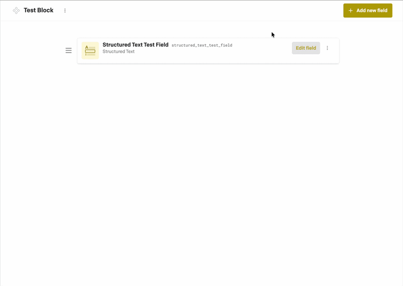
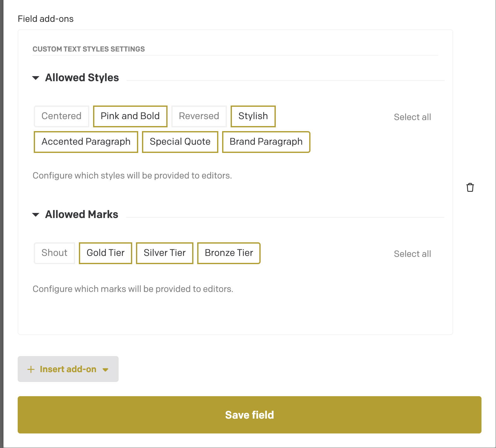

# Per-field settings

By default, every custom style and mark you add in the plugin settings is available in **every** Structured Text field in your project.

Often you want less than that. A hero block might only need a "Centered" heading, while a product description needs the "Gold Tier" and "Silver Tier" marks. Per-field settings let you pick which styles and marks each Structured Text field gets.

Because Structured Text fields live inside models and blocks, this is how you control the available styles and marks per block.

## Set it up

1. In DatoCMS, open the **Schema** and go to the model or block that holds your Structured Text field.
2. Open the field settings and go to the **Presentation** tab.
3. Under **Field add-ons**, click **Insert add-on** and choose **Custom Text Styles**.
4. Under **Allowed Styles**, click the styles this field should offer. Selected styles have a highlighted border.
5. Under **Allowed Marks**, do the same for marks.
6. Click **Save field**.

Use **Select all** and **Deselect all** to toggle everything at once.

## Example

With the settings above, editors of this field can use:

- Styles: Pink and Bold, Stylish, Accented Paragraph, Special Quote, Brand Paragraph
- Marks: Gold Tier, Silver Tier, Bronze Tier

"Centered", "Reversed" and "Shout" exist in the plugin settings, but are hidden in this field.

## How the Add-on works

| Field add-on | Result |
| --- | --- |
| Not added | All styles and marks are available |
| Added, nothing deselected | All styles and marks are available |
| Added, some deselected | Only the selected styles and marks are available |
| Added, everything deselected | No custom styles or marks are available |

Removing the add-on from a field (the trash icon) brings back all styles and marks.

## Good to know

- Add a new style or mark in the plugin settings and it is **not** automatically selected in fields that have the add-on. Open those fields and select it.
- Deselecting a style or mark does not change existing content. Text that already uses it keeps its `style` or `marks` value. It just can no longer be applied by editors.
- Styles and marks are matched by **slug**. If you rename a slug in the plugin settings, re-select it in each field.
